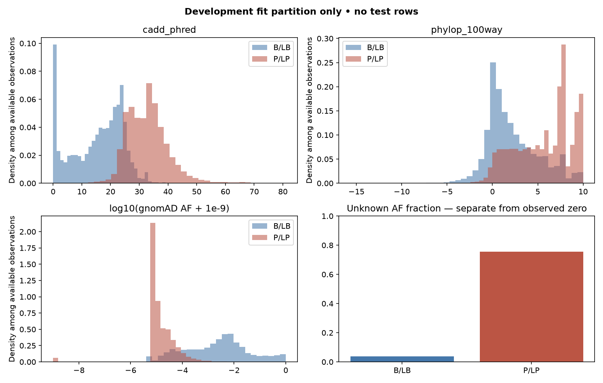
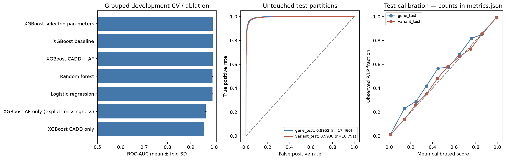
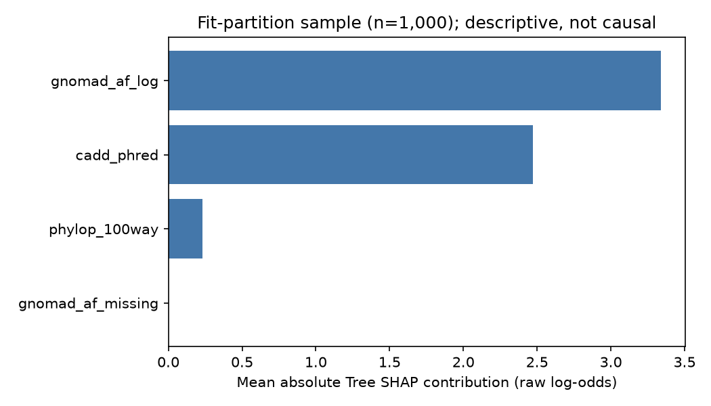

# Ölçülen yeni koşu sonuçları

Tarih: 7 Ekim 2026. Koşu: `research-v2`. Aşağıdaki değerler tamamlanmış yeni koşudan üretilir; eski `0.9962` sonuç yeni başarı olarak kullanılmaz.

## İç değerlendirme

| Partition | N | B/LB | P/LP | ROC-AUC | Average precision | Brier | Log loss |
|---|---:|---:|---:|---:|---:|---:|---:|
| variant_test | 16,791 | 6,818 | 9,973 | 0.993771 | 0.995282 | 0.027307 | 0.096488 |
| gene_test | 17,460 | 7,611 | 9,849 | 0.995308 | 0.996176 | 0.024570 | 0.085523 |

Gen testi geliştirme kohortundaki bağlı gen gruplarından ayrıdır. Varyant testi ve kalibrasyon satır kimlikleri fit satırlarından ayrıdır. Model/özellik/tuning kararları fit-only gen ayrık CV ile alınmıştır. Hasta/VUS klinik olasılığı iddiası yoktur.

## Zaman bazlı dış kontrol

Temmuz 2026'daki tüm etiketli kohort kimlikleri Ekim 2026 dış değerlendirmesinden çıkarılmıştır. Reclassified VUS grubu, Temmuz'da VUS olup Ekim'de P/LP veya B/LB olarak kayıtlı varyantları içerir.

| Grup | N | B/LB | P/LP | ROC-AUC | Brier |
|---|---:|---:|---:|---:|---:|
| new_labeled_variants | 6,996 | 3,049 | 3,947 | 0.993656 | 0.032664 |
| reclassified_vus | 15 | 8 | 7 | 0.839286 | 0.268941 |

Bu, zaman bazlı ClinVar etiket kontrolüdür. Genetik hastalık riskini, penetransı veya bağımsız fonksiyonel doğruluğu kanıtlamaz. ClinVar etiketleri hesaplamalı kanıtlardan etkilenmiş olabilir.

**Reclassified VUS örneklemi yalnızca 15 varyanttır. AUC=0.839286, Brier=0.268941. Bu küçük gruptaki daha zayıf sonuç geniş VUS popülasyonu için güçlü doğrulama sayılmaz. Yeni etiketli grup, önceki 2+ yıldızlı eğitim kohortuna yeni uygun hale gelen kimliklerdir; her kimliğin ilk kez ClinVar'da etiketlendiği iddiası değildir.**

## Model geliştirme

Fit satırları: **53,731**. Kalibrasyon satırları: **13,433**. CV fold: **5**. Arama iterasyonu: **12**.

En iyi geliştirme CV ROC-AUC: `0.994104`. Seçilen en iyi CV değerinde arama iyimserliği olabilir; bu değer dış test değildir.

```json
{
  "subsample": 0.8,
  "n_estimators": 400,
  "min_child_weight": 5,
  "max_depth": 3,
  "learning_rate": 0.03,
  "colsample_bytree": 1.0
}
```

## VUS çıktı kümesi

```json
{
  "n_scored": 298885,
  "by_direction": {
    "Indeterminate": 144905,
    "Pathogenic direction": 102199,
    "Benign direction": 51781
  },
  "unknown_af": 134651,
  "known_out_of_scope_not_scored": 0
}
```

Bu skorlar ClinVar VUS sınıflarını değiştirmez. Eşik bantları yalnızca gösterim/önceliklendirme içindir.

## Kaynak ve tekrar üretim

Eğitim snapshot: `variant_summary_2026-07.txt.gz`

SHA-256: `b3da921c707ff50cb4822f04d961834a9e89ef864b4c28bb5308245b93ac4077`

VUS snapshot: `variant_summary_2026-10.txt.gz`

SHA-256: `a6a58df4d9049c9187a79a8fb4e70f1f3b5550e1708c6c74b7be0b268f5032da`

Anotasyon kaynak metaverisi, namespace, tüm model/özellik sırası, bağımlılık sürümleri ve kod hash'leri `manifest.json` içinde saklanır. Tam kaynak dataset/cache yerel `data/` altında korunur. NCBI snapshot'ları tarihli arşiv URL'lerinden yeniden indirilebilir; tam anotasyon tekrarında aynı cache veya aynı kaynak sürümü gerekir.

## Grafikler







## Teknik doğrulama

```json
{
  "pytest_tests": 60,
  "pytest_failures": 0,
  "ruff_lint": "passed",
  "ruff_format": "passed",
  "pip_check": "passed",
  "offline_notebook_6_code_cells": "passed",
  "isolated_jupyter_restart_run_all": "passed",
  "training_source_hashes_match_git_base_commit": "passed",
  "live_query": {
    "annotation_status": "ok",
    "live_source_namespace_matches": true,
    "model_score": 0.9242546795290338,
    "direction": "Pathogenic direction"
  },
  "real_bundle": {
    "default_app_pages": "passed",
    "manual_unknown_af": "passed",
    "literal_gene_filter": "passed",
    "hfe_scope_rejection": "passed",
    "mandatory_and_optional_checksums": "passed",
    "variant_gene_and_cv_fold_disjointness": "passed",
    "test_prediction_rows": 34251,
    "max_saved_prediction_difference": 0.0,
    "native_shap_additivity": "passed on 100 test rows",
    "features": [
      "cadd_phred",
      "phylop_100way",
      "gnomad_af_log",
      "gnomad_af_missing"
    ],
    "shap_rows": 100,
    "shap_base_rows": 100
  }
}
```

ROC-AUC aralıkları sınıfa göre tabakalı satır bootstrap'ına dayanır; gen kümelenmesi ve domain shift bu aralıklarda modellenmez. Name desenleri consequence proxy'sidir; kesin VEP/missense-only iddiası yapılmaz. Ayrıntılı alt grup, kutu sayıları ve tahmin kimlikleri bundle içinde saklanır.

## Kohort seçimi ve nadir AF alt grupları

| Kaynak | Benign önce/sonra | Patojenik önce/sonra | VUS önce/sonra |
|---|---:|---:|---:|
| Temmuz | 280,580 / 41,700 | 61,750 / 59,715 | 291,812 / 281,310 |
| Ekim | 332,185 / 44,353 | 65,078 / 62,986 | 309,879 / 298,885 |

| Test / alt grup | N | B/LB | P/LP | ROC-AUC |
|---|---:|---:|---:|---:|
| variant_test / af_unknown | 7,807 | 248 | 7,559 | 0.970744 |
| variant_test / af_observed_zero | 41 | 12 | 29 | 0.939655 |
| variant_test / af_observed_rare_le_1e_4 | 3,377 | 1,136 | 2,241 | 0.956495 |
| variant_test / af_observed_gt_1e_3 | 4,069 | 4,058 | 11 | 0.873135 |
| variant_test / stop_gain_name_proxy | 3,910 | 39 | 3,871 | 0.950566 |
| variant_test / splice_name_proxy | 2,120 | 146 | 1,974 | 0.998793 |
| variant_test / missense_name_proxy | 10,444 | 6,319 | 4,125 | 0.987781 |
| variant_test / expert_or_guideline_review | 1,330 | 274 | 1,056 | 0.979276 |
| gene_test / af_unknown | 7,040 | 153 | 6,887 | 0.970979 |
| gene_test / af_observed_zero | 46 | 8 | 38 | 0.940789 |
| gene_test / af_observed_rare_le_1e_4 | 3,686 | 949 | 2,737 | 0.957846 |
| gene_test / af_observed_gt_1e_3 | 5,105 | 5,087 | 18 | 0.932639 |
| gene_test / stop_gain_name_proxy | 4,235 | 29 | 4,206 | 0.954757 |
| gene_test / splice_name_proxy | 2,239 | 189 | 2,050 | 0.998450 |
| gene_test / missense_name_proxy | 10,716 | 7,128 | 3,588 | 0.990571 |
| gene_test / expert_or_guideline_review | 845 | 156 | 689 | 0.983532 |

Bu alt gruplar önceden tanımlanan betimsel ölçümlerdir. az sayıda benign/patojenik kayıt bulunan gruplar dikkatle okunmalıdır. Name desenleri yalnızca consequence proxy'sidir.
